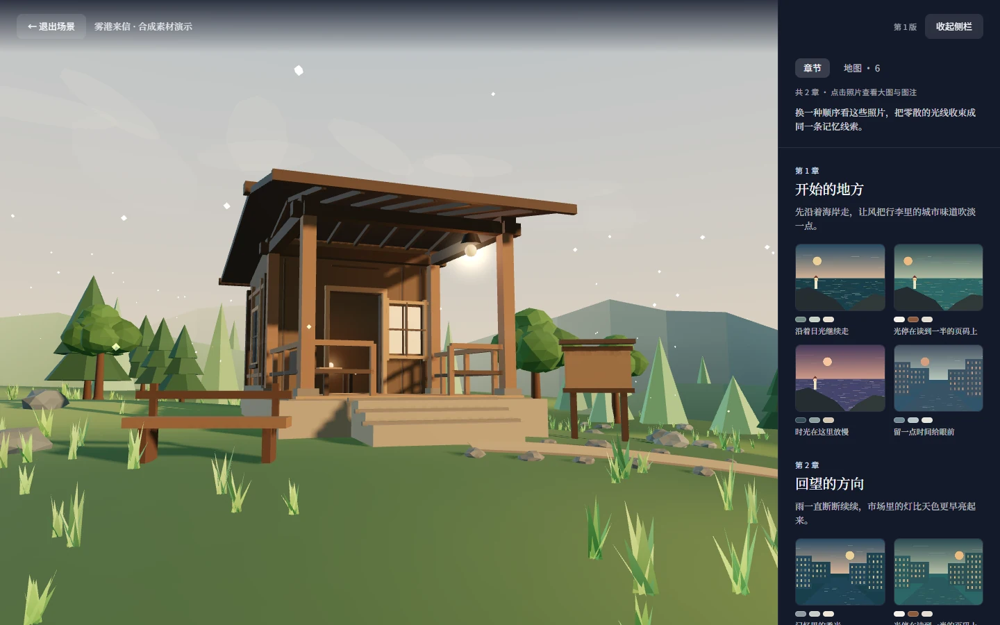

# Momentarium

**Turn a collection of photos into an exhibition you can step inside.**

Momentarium is a personal memory archive and exhibition builder. Start with a set of photos, shape them into chapters with an AI curator, and create a 3D environment inspired by their mood. Publish the result as a link that visitors can open without an account.

[Run the demo](#run-locally) · [Explore the architecture](#architecture) · [Run the tests](#tests)



*The public viewer running locally in fake mode with synthetic demo images. The application interface is in Chinese.*

## From photos to an exhibition

- **Curate the story.** AI suggests themes, chapters, and captions. The curator can edit, reorder, and approve the changes before saving them.
- **Build a place for the story.** Three.js creates an explorable environment around the collection's mood. Visitors can orbit the scene and open photos, captions, and memories from the chapter sidebar.
- **Invite another perspective.** Invitees can submit a photo and a memory. The curator decides what enters the draft and which locations visitors can see.
- **Publish a version.** Each publication freezes the exhibition, photos, and selected scene in a read-only snapshot. The draft stays editable for the next publication.


## Run locally

The seeded demo includes a published exhibition, sample contributions, map locations, and a scene revision candidate. Fake mode uses deterministic model responses and requires no AI API key.

**Requirements** · JDK 17, sbt 1.13.0, Node.js 24, pnpm 12, and PostgreSQL 18. The commands below use PowerShell 7 on Windows. The demo and smoke scripts use Windows image processing APIs.

### 1. Prepare PostgreSQL

Connect to `psql` as a PostgreSQL administrator and enter the following commands.

```sql
CREATE ROLE momentarium LOGIN;
\password momentarium
CREATE DATABASE momentarium OWNER momentarium;
```

From the repository root, run `Copy-Item backend/.env.example backend/.env`. Set `DB_PASSWORD` in the new file to the role's password and keep `AI_MODE=fake`. The template uses PostgreSQL on port `5432`. Adjust `DB_URL` for a different port. The backend creates its tables on startup.

### 2. Build and start the app

Build the frontend, then start the backend. Open each terminal at the repository root.

```powershell
# Terminal 1
cd frontend
pnpm install --frozen-lockfile
pnpm build
```

```powershell
# Terminal 2
cd backend
sbt -Xss8m run
```

The Scala backend serves the built frontend at http://localhost:8080. For frontend development, run `pnpm dev` inside `frontend/` and open http://localhost:5173. Vite forwards API requests to port `8080`.

### 3. Seed the sample exhibition

In a third terminal, run the seed script from the repository root.

```powershell
$env:MOMENTARIUM_DEMO_PASSWORD = Read-Host -MaskInput 'Choose a local demo password'
pwsh scripts/demo/seed.ps1 -BaseUrl http://localhost:8080
Remove-Item Env:MOMENTARIUM_DEMO_PASSWORD
```

Open the public URL printed by the script to view the exhibition. To inspect the workspace, sign in as `demo_owner` with the password you chose. Use 8–72 characters and keep the same password when reseeding an existing demo database. Seed inputs are [synthetic fixtures](tests/fixtures/README.md).

## Architecture

| Layer | Implementation |
| --- | --- |
| Frontend | React, TypeScript, Vite, Tailwind CSS, Three.js, and Leaflet |
| Backend | Scala 3, Cats Effect, http4s, Circe, and PostgreSQL |
| API | Message-based handlers and [shared JSON fixtures](docs/contracts/README.md) decoded by tests on both sides |
| Model integration | Separate text, vision, and review capabilities with fake and live modes |

The live scene pipeline turns curatorial context into a scene brief, then produces Three.js code for a sandboxed iframe. The browser collects runtime checks and four viewpoints. The backend combines that evidence with a vision-model review and can attempt repairs or revisions before using a bundled fallback scene. The [scene design notes](docs/scene-prompt-spec.md) and [API contract](docs/api-contract.md) describe the boundaries in more detail.

Uploads and derived images are stored on the host filesystem. Live mode sends the inputs needed for generation and review to the configured model gateway. Map tiles can make requests to the configured tile provider in either mode. Visible locations on a published exhibition come from the curator's publication settings.

## Tests

The Scala integration suite uses two additional databases.

```sql
CREATE DATABASE momentarium_test OWNER momentarium;
CREATE DATABASE momentarium_ai OWNER momentarium;
```

With `backend/.env` configured, run the following commands from the repository root. Adjust both JDBC URLs if PostgreSQL uses a different port.

```powershell
Push-Location backend
$env:DB_URL = 'jdbc:postgresql://localhost:5432/momentarium_test'
$env:TEST_AI_DB_URL = 'jdbc:postgresql://localhost:5432/momentarium_ai'
$env:AI_MODE = 'fake'
sbt -Xss8m test
Remove-Item Env:DB_URL, Env:TEST_AI_DB_URL, Env:AI_MODE
Pop-Location

Push-Location frontend
pnpm test
pnpm build
Pop-Location

# With the fake-mode backend running
pwsh tests/e2e/smoke.ps1 -BaseUrl http://localhost:8080 -IncludeCuration -IncludeScene -IncludeReview -IncludePublish
```

See the [browser regression instructions](tests/e2e/README.md), [developer documentation](docs/README.md), and [standalone Three.js prototype](prototypes/three/README.md).

## Credits

Momentarium was designed and built as a solo project. It is released under the [MIT License](LICENSE). [Third-party notices](THIRD_PARTY_NOTICES.md) lists the bundled assets and their licenses.
